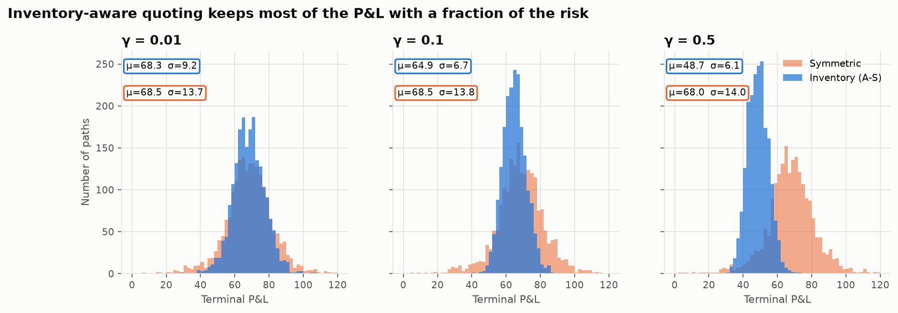
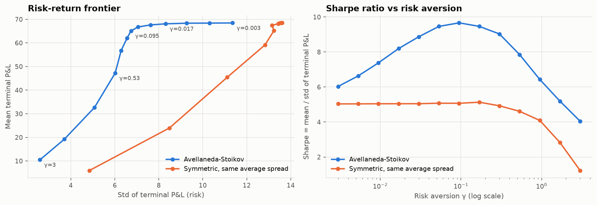
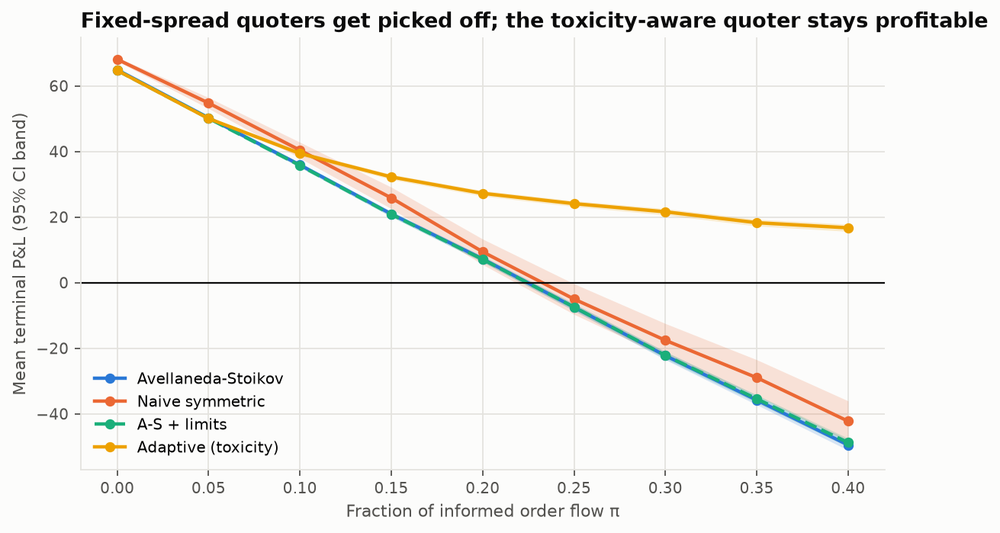
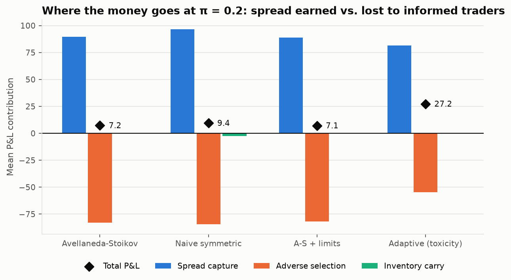
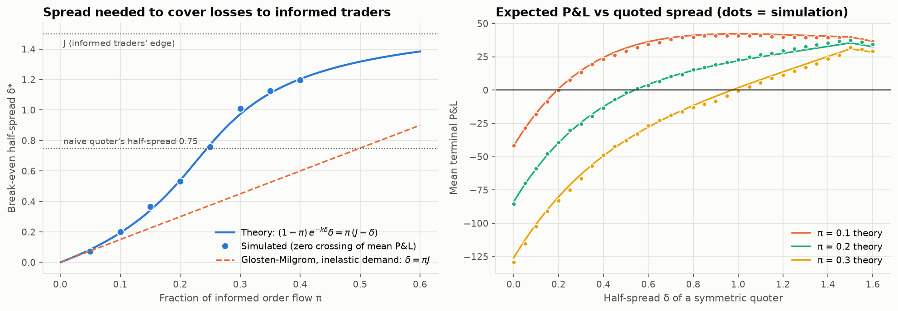

# Market Making under Inventory Risk and Adverse Selection

A market maker earns the bid-ask spread, but two things can take that money back:
**inventory risk** (holding a position while the price moves) and **adverse selection**
(trading with people who know where the price is going). This project builds a Monte
Carlo simulator of a single-stock market maker, implements the Avellaneda-Stoikov (2008)
optimal quoting model, **reproduces the paper's results** (similar mean P&L, about half
the risk), then adds Glosten-Milgrom-style informed traders. It shows that a fixed-spread
quoter is **picked off** once about 23% of order flow is informed, derives and checks the
**break-even spread** against theory, and builds an **adaptive quoter**. That quoter
learns how toxic its order flow is from post-trade mark-outs and **stays profitable at every
informed-trader level tested**, while the other strategies lose money.



## Key results

All numbers: 2,000 seeded Monte Carlo paths, paper parameters
(s = 100, T = 1, σ = 2, dt = 0.005, q₀ = 0, A = 140, k = 1.5). `python scripts/run_all.py`
reproduces every number and figure in about 15 seconds.

**1. Avellaneda-Stoikov replication.** The inventory strategy gives up a little mean P&L
for a large cut in risk (paper values in brackets):

| γ | Strategy | Mean P&L | Std P&L | Std final q |
|---|---|---|---|---|
| 0.01 | Inventory (A-S) | 68.3 (66.8) | 9.2 (8.8) | 5.3 (4.7) |
| 0.01 | Symmetric | 68.5 (67.4) | 13.7 (13.4) | 8.7 (8.7) |
| 0.1 | Inventory (A-S) | 64.9 (62.9) | **6.7** (5.9) | **3.0** (2.8) |
| 0.1 | Symmetric | 68.5 (67.2) | 13.8 (13.4) | 8.8 (8.7) |
| 0.5 | Inventory (A-S) | 48.7 (33.9) | 6.1 (4.7) | 1.9 (1.9) |
| 0.5 | Symmetric | 68.0 (66.2) | 14.0 (14.5) | 9.2 (8.7) |

At γ = 0.1 the A-S quoter keeps 95% of the symmetric quoter's mean P&L with **51% less
P&L volatility**, and its Sharpe ratio nearly doubles (9.7 vs 5.0). As in the paper, the symmetric benchmark
quotes a spread of (2/γ)ln(1 + γ/k), the "spread" column the paper reports. One honest gap:
at γ = 0.5 I get a mean of 48.7, not the paper's 33.9. The risk numbers match, and the paper
does not fully specify its simulation (for example, how quotes that cross the mid are
handled).

**2. Risk-aversion frontier.** For every γ, A-S beats a symmetric quoter with the same
average spread. Sharpe (mean/std of terminal P&L) peaks around γ ≈ 0.1.



**3. Adverse selection.** Mean terminal P&L (Sharpe in brackets) as the informed fraction π rises
(informed traders know about a ±1.5 jump):

| π | Naive symmetric | Avellaneda-Stoikov | A-S + limits | **Adaptive (toxicity)** |
|---|---|---|---|---|
| 0.0 | 68.1 (5.1) | 64.9 (9.7) | 64.7 (9.7) | 64.7 (9.6) |
| 0.2 | 9.4 (0.1) | 7.2 (0.3) | 7.1 (0.4) | **27.2 (1.4)** |
| 0.3 | −17.6 (−0.2) | −22.3 (−0.8) | −22.2 (−0.9) | **21.6 (1.0)** |
| 0.4 | −42.2 (−0.3) | −49.5 (−1.4) | −48.8 (−1.6) | **16.7 (0.7)** |



Inventory control does **not** protect against adverse selection: A-S loses money as fast
as the naive quoter. Adverse selection is a different risk from inventory risk. The P&L
decomposition shows where the money goes. Every strategy captures a similar spread. The
adaptive quoter loses about a third less to informed traders (−55 vs −83 at π = 0.2)
because it quotes close to J, where an informed trader's edge is small.



**4. Break-even spread.** The simulated break-even half-spread matches the closed form at
every π, to within the grid's resolution. It is well above the Glosten-Milgrom value πJ,
because widening also scares away uninformed customers (k > 0).



A sample path (quotes, fills and inventory) is in
[`figures/sample_path.png`](figures/sample_path.png).

## The maths in brief

**Market.** The mid follows dS = σ dW (+ jumps). An uninformed market order trades with a quote
at distance δ from mid with intensity λ(δ) = A e^(−kδ): quote tighter, trade more,
earn less per trade.

**Avellaneda-Stoikov.** A market maker with exponential (CARA) utility, risk aversion γ
and horizon T quotes around a *reservation price* rather than the mid:

- r = s − q·γσ²(T − t). When long (q > 0), r < s, so both quotes move down: we sell more
  easily and buy less, which pushes inventory back to zero. The skew grows with risk
  aversion, volatility and the time left.
- Total spread = γσ²(T − t) + (2/γ)·ln(1 + γ/k). The first term pays for inventory risk.
  The second is the mark-up a monopolist can charge given how elastic order flow is
  (→ 2/k as γ → 0).

**Adverse selection (Glosten-Milgrom).** A fraction π of market orders are informed: they
know the mid is about to jump by ±J and trade only when that beats our quote. Per side,
the expected P&L rate of a half-spread δ is

  (1 − π)·A·e^(−kδ)·δ  −  π·A·(J − δ)·1{δ < J}

The first term is spread earned from uninformed orders. The second is the loss to informed
traders. Inventory P&L has zero mean because the mid is a martingale. **The spread must
cover the expected loss to informed traders**, so the break-even δ* solves
(1 − π)e^(−kδ)δ = π(J − δ). If uninformed demand ignores the price (k = 0), this gives
Glosten-Milgrom's δ* = πJ. A market maker who cannot tell who is informed charges
everyone for the informed traders' expected profit.

**Adaptive quoter.** After each fill we record its *mark-out*: how far the mid moved against us
on the next step. Uninformed fills average zero and informed fills lose J. An exponentially
weighted average of mark-outs per side (α = 0.1, a memory of about 10 fills) estimates the
adverse-selection cost per fill. We add it to that side's quote distance on top of A-S with
limits. So when buyers lift our ask and the price keeps rising, the ask widens, and the
premium decays once fills stop losing money. The quoter never sees π or J, and the result
holds for any α from 0.05 to 0.3.

**P&L attribution** (exact, every step, unit-tested):
d(cash + qS) = n_b(S − bid) + n_a(ask − S) **[spread]** + (n_b − n_a)ΔS **[mark-out / adverse
selection]** + q·ΔS **[inventory carry]**.

## How to run

```bash
pip install -e ".[test]"        # or: pip install numpy scipy matplotlib pandas pytest
pytest                          # 20 tests, about 1 second
python scripts/run_all.py       # all experiments -> figures/ and results/
```

## Project structure

```
mmsim/
  market.py        MarketParams; closed-form expected P&L and break-even spread
  strategies.py    A-S formulas; Symmetric, Avellaneda-Stoikov, A-S + limits, Adaptive quoter
  simulator.py     vectorised Monte Carlo simulator + SimResult (P&L, fills, decomposition)
scripts/run_all.py experiments (i)-(vi): tables to results/, figures to figures/
tests/             formulas, accounting identity, fill rates vs λ(δ)dt, limits, theory checks
```

Design choices worth knowing:
- **Time-stepped event simulation**, as in the paper. In each step dt, Poisson arrivals are
  Bernoulli(λ·dt) events. The simulation is vectorised over paths, so 2,000 paths take well under 0.1 s.
- **Common random numbers.** All randomness is drawn before the run and does not depend on
  the quotes, so every strategy sees the same price paths and order arrivals. Differences in
  P&L come from the strategy, not from luck.
- **Risk check.** Hard position limits are enforced by the simulator as well as by the strategy.

## What I learned

- Optimal market making is a trade-off between earning the spread and holding risk. Most of the
  A-S benefit comes from the inventory *skew*, not from a wider spread.
- Inventory risk and adverse selection are different problems. A-S manages the first
  well and does nothing about the second. You measure adverse selection with
  **mark-outs**, which is how real desks judge whether a counterparty's flow is toxic.
- The break-even spread rises sharply (not linearly) with π once customers are
  price-sensitive. A market maker who quotes too tight against informed flow loses money on
  every trade.
- Validate a simulator against closed forms before trusting it. The tests check the
  accounting identity at every step and check simulated mean P&L against theory.

## Extensions

- **Persistent informed flow** (Kyle-style insiders who split orders), where order-flow
  imbalance predicts future moves and the quoter should also *skew*, not just widen.
- **Options market making with delta hedging**: quote a vol surface, hedge with the underlying,
  manage vega and gamma inventory.
- **Multi-asset** A-S (Guéant, Lehalle, Fernandez-Tapia) with correlated inventory risk.
- **Queue position and tick size**, using a limit-order-book model instead of the λ(δ) reduced form.
- **Real LOB data**: calibrate A and k from trade-through rates, and measure mark-outs on real fills.

*Reference:* M. Avellaneda and S. Stoikov (2008), "High-frequency trading in a limit order book",
*Quantitative Finance* 8(3); L. Glosten and P. Milgrom (1985), *Journal of Financial Economics* 14(1).
